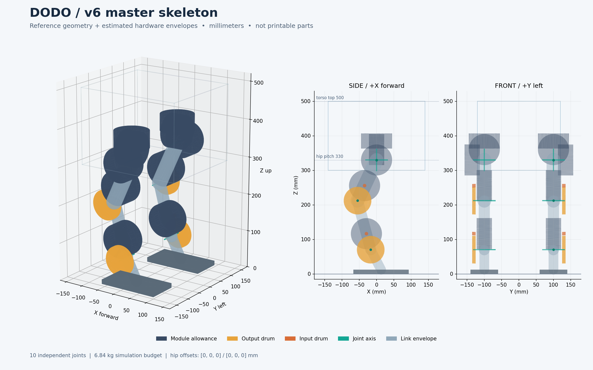

# Dodo v6 master skeleton — first CAD study

Status: editable reference geometry and estimated envelopes. **Not printable or manufacturing-ready parts.**

Source: `simulation/models/build_model_v6.py`. See manifest for the SHA-256 and exact configuration. Dimensions are in mm. No simulation files are changed.

## Deliverables

- `../assemblies/dodo_v6_master.step`: named skeleton, ten actuator-module allowances, knee/ankle drum studies and torso bounding cage.
- `../assemblies/dodo_v6_skeleton.step`: joint axes, links, feet and torso reservation.
- `../assemblies/dodo_v6_hardware_envelopes.step`: ten module allowances and eight distal drum envelopes.
- `../assemblies/dodo_v6_manifest.json`: joint frames/limits, module centers, source provenance and mass budget.
- `dodo_v6_clearances.json`: nominal and sampled travel/step diagnostics.

## Geometry and conventions

| Item | Value |
| --- | --- |
| Torso top | 500.0 |
| Hip pitch height | 330.000 |
| Hip pitch spacing | 200.000 |
| Thigh / shank | 130.0 / 147.0 |
| Knee / ankle motor center spacing | 48.0 |
| Sole plane at neutral | Z = 0.189 |
| Total mass allowance | 6.84 kg |
| Whole-body COM | [-9.857, 0.0, 297.905] |

The 0.189 mm sole clearance is inherited from v6 rounding; no silent height correction is applied. The torso bounding cage is not a solid shell and may intentionally contain hardware. Joint order is yaw → roll → pitch → knee → ankle. Both hip drives are independent. All q values are relative to neutral; do not add the neutral pitch offsets a second time.

### Joint datums

| Joint | Origin XYZ | Axis XYZ | Relative travel (deg) |
| --- | --- | --- | --- |
| left_hip_yaw | [0.0, 100.0, 330.0] | [0.0, 0.0, 1.0] | [-30.0, 30.0] |
| left_hip_roll | [0.0, 100.0, 330.0] | [1.0, 0.0, 0.0] | [-25.0, 25.0] |
| left_hip_pitch | [0.0, 100.0, 330.0] | [0.0, 1.0, 0.0] | [-60.0, 60.0] |
| left_knee_pitch | [-54.94, 100.0, 212.18] | [0.0, 1.0, 0.0] | [-60.0, 60.0] |
| left_ankle_pitch | [-16.894, 100.0, 70.189] | [0.0, 1.0, 0.0] | [-60.0, 60.0] |
| right_hip_yaw | [0.0, -100.0, 330.0] | [0.0, 0.0, 1.0] | [-30.0, 30.0] |
| right_hip_roll | [0.0, -100.0, 330.0] | [1.0, 0.0, 0.0] | [-25.0, 25.0] |
| right_hip_pitch | [0.0, -100.0, 330.0] | [0.0, 1.0, 0.0] | [-60.0, 60.0] |
| right_knee_pitch | [-54.94, -100.0, 212.18] | [0.0, 1.0, 0.0] | [-60.0, 60.0] |
| right_ankle_pitch | [-16.894, -100.0, 70.189] | [0.0, 1.0, 0.0] | [-60.0, 60.0] |

## Hardware confidence

The ten cylinders are aggregate simulation module allowances: diameter 90 × axial length 44. They are not measured motor geometry and do not certify that a complete capstan actuator fits. No mounting holes or purchased-part interfaces have been invented.

Distal drum radii come from v6 (40 / 5 mm). The 10 mm drum width and 3 mm axial gap are CAD study assumptions. Motors remain at the simulation locations; only drum envelopes occupy the outboard plane. Module mass already includes drums/bearings/driver; this view adds no mass.

Unresolved hardware is listed in `../source/envelopes_v6.json`. Driver/electronics and bearing details remain unplaced until dimensions are verified. The `8308` name is not a verified motor outside diameter.

## Clearance findings

Checks are enabled: True. The results below concern estimated envelope solids, not actual manufactured collisions.

Nominal overlapping pairs: **16**. Intentional module-to-owner-link attachments and torso cage overlaps are excluded. See the JSON scope for the tested pair categories; drum-to-link, internal interfaces and floor clearance are not covered by this pass.

| Envelope A | Envelope B | Intersection (mm³) |
| --- | --- | ---: |
| left_hip_yaw_module | left_hip_roll_module | 126743.1 |
| left_hip_yaw_module | left_hip_pitch_module | 14985.8 |
| right_hip_yaw_module | right_hip_roll_module | 126743.1 |
| right_hip_yaw_module | right_hip_pitch_module | 14985.8 |
| left_hip_roll_module | left_hip_pitch_module | 62705.4 |
| left_hip_pitch_module | left_knee_module | 1797.0 |
| right_hip_roll_module | right_hip_pitch_module | 62705.4 |
| right_hip_pitch_module | right_knee_module | 1797.0 |
| left_hip_roll_module | left_thigh_geom | 35156.5 |
| left_hip_pitch_module | left_thigh_geom | 7925.7 |
| left_knee_module | left_shank_geom | 5721.1 |
| left_ankle_module | left_hock_geom | 3636.8 |
| right_hip_roll_module | right_thigh_geom | 35156.5 |
| right_hip_pitch_module | right_thigh_geom | 7925.7 |
| right_knee_module | right_shank_geom | 5721.1 |
| right_ankle_module | right_hock_geom | 3636.8 |

### Distal travel sweep

Each knee/ankle is sampled every 5° from −60° to +60°, all other joints neutral. A module-to-child-link overlap identifies a region needing actual link/shaft-plane design.

| Joint | Sampled relative angles with overlap |
| --- | --- |
| left_knee_pitch | [-60.0, -55.0, -50.0, -45.0, -40.0, -35.0, -30.0, -25.0, -20.0, -15.0, -10.0, -5.0, 0.0, 5.0, 10.0, 15.0, 20.0, 25.0, 30.0, 35.0, 40.0, 45.0, 50.0, 55.0, 60.0] |
| left_ankle_pitch | [-60.0, -55.0, -50.0, -45.0, -40.0, -35.0, -30.0, -25.0, -20.0, -15.0, -10.0, -5.0, 0.0, 5.0, 10.0, 15.0, 20.0, 25.0, 30.0, 35.0, 40.0, 45.0, 50.0, 55.0, 60.0] |
| right_knee_pitch | [-60.0, -55.0, -50.0, -45.0, -40.0, -35.0, -30.0, -25.0, -20.0, -15.0, -10.0, -5.0, 0.0, 5.0, 10.0, 15.0, 20.0, 25.0, 30.0, 35.0, 40.0, 45.0, 50.0, 55.0, 60.0] |
| right_ankle_pitch | [-60.0, -55.0, -50.0, -45.0, -40.0, -35.0, -30.0, -25.0, -20.0, -15.0, -10.0, -5.0, 0.0, 5.0, 10.0, 15.0, 20.0, 25.0, 30.0, 35.0, 40.0, 45.0, 50.0, 55.0, 60.0] |

### Candidate step geometry

21 samples, fixed torso/right foot, 40 mm swing lift, +/-20 mm fore/aft. Geometric diagnostic only; not a balanced or dynamically validated gait. Sampled checks do not prove continuous clearance.

Frames with reported envelope overlaps: 21/21. All sampled targets inside joint limits: True.

## Next decisions

1. Measure the motor and controller, then replace the aggregate allowance with separate purchased-part geometry.
2. Choose the hip axis spacing and motor orientations. V6 exposes offsets but its nominal committed values are still zero. Keep roll axes at/inboard of ±100 mm and pitch spacing near 200 mm; prefer vertical offsets.
3. Design the distal child-link path around the motor envelope, together with the output shaft/bearings and drum planes.
4. Re-run clearance studies and put any physical axis/mass changes back into simulation before printing structural parts.

A collision-free physical layout is not claimed. This study makes the remaining packaging work measurable.
